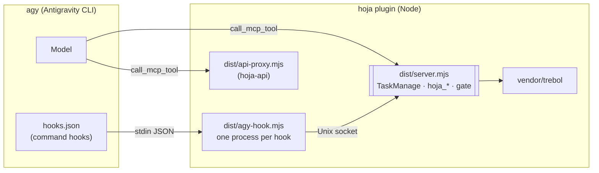

<div align="center">


# Hoja for Antigravity

**Tasks that can't be marked done without proof — and a trace of how the work was done.**
Trebol's TaskManage, its task-enforcement gate, Hoja issue sync and session traces — as an Antigravity CLI plugin.

[](LICENSE)
[](#verify-it-yourself)
[](https://github.com/hoja-work/hoja-claude-plugin)
[](https://github.com/hoja-work/hoja-codex-plugin)

</div>

---

Agents say "done" too easily. Hoja makes "done" mean something:

- **Every task has acceptance questions.** "Do the tests pass?" "Is the README updated?" — written up front.
- **Completion needs evidence that resolves.** Each answer cites `src/app.ts#L10-L40`, `README.md#Install`, or
  `tool:Bash#3` — a real file or a real tool result from *this* conversation, read from Antigravity's transcript.
  Made-up evidence is rejected.
- **Nothing mutates without a task.** A gate denies `write_file`, edits, non-read-only `run_command`s and
  write-capable MCP tools until a task is focused. Reads are always free, and what the gate allows still goes
  through Antigravity's own permissions.
- **Your tracker stays current by itself.** With Hoja mode on, each top-level task becomes a Hoja issue and each
  of its child tasks a sub-issue; progress is rewritten in place, and an evidenced completion moves it to Done.
- **Nobody has to remind the agent.** Every message you write tells the agent how to register it (a new task, the
  open one, or a child of the active one), and when a reply ends after real work with its task unreconciled or
  untracked, the agent is sent back once to complete it with evidence or note what is left.
- **Every conversation leaves a trace.** Turns, model calls with token counts, every tool call with its duration and
  outcome, and gate blocks are recorded; a completed task's trace is attached to its issue and opens in Hoja's
  trace viewer.

This is not a re-implementation. The engine, the gate and Hoja mode are
[Trebol](https://github.com/cloverinternational/trebol)'s own code, vendored byte-for-byte and hash-checked. The
plugin only translates between Antigravity's hooks and Trebol's runtime, with the same adapter source as the
[Claude Code](https://github.com/hoja-work/hoja-claude-plugin) and [Codex](https://github.com/hoja-work/hoja-codex-plugin)
plugins.

## Quick start

```bash
git clone https://github.com/hoja-work/hoja-antigravity-plugin
agy plugin install ./hoja-antigravity-plugin
```

No build step: `dist/` holds the bundled entry points and the only runtime requirement is `node` (20+) on `PATH`.
To try it without installing, copy the folder into a workspace's `.agents/plugins/hoja/`; Antigravity loads it from
there for that workspace only.

Then work as usual, and type `hoja:setup` to check everything. An abridged session:

```text
> add a --json flag to the CLI

● run_command  touch src/cli/json.ts
  ⎿  denied by pre-tool hook: [TASK ENFORCEMENT - BLOCKED] YOU CANNOT EXECUTE ANY TOOL WITHOUT A TASK …

● hoja_hoja / TaskManage  create "Add --json flag" (questions: flag-works, tests-pass), in_progress, active
  ⎿  succeeded · published HOJA-712

● run_command  touch src/cli/json.ts … write_file … run_command  npm test

● hoja_hoja / TaskManage  completed · flag-works ← tool:Bash#2 · tests-pass ← tool:Bash#3
  ⎿  succeeded · HOJA-712 → Done
     Hoja trace: attached this session's trace to HOJA-712 (Antigravity trace · 4m 2s · 1 turn · 11 tool calls · 1 blocked)
```

## What you get

| | |
| --- | --- |
| **`TaskManage`** | Ordered, durable tasks with dependencies, sub-tasks, notes and 1–12 acceptance questions each. Completion is validated against the workspace and the conversation's transcript. |
| **Task gate** | Trebol's Swarm hook pipeline: denies non-read-only tools without a focused task (`block`), or only nudges (`advise`). Also: the completion nudge, the task-maintenance nudge, the bare-`sleep` blocker and the stdin-conflict guard. |
| **Auto-continue** | When a gate denial ends the turn, the `Stop` hook answers `continue` with exactly what to do, within the same bounded budget Trebol uses. |
| **Hoja mode** | `hoja_list`, `hoja_get` and `hoja_project`, plus automatic publication: one Hoja issue per top-level task and one sub-issue per child of it (`hoja:"local"` keeps a step out), acceptance questions in the description, an evidence comment and Done on completion. |
| **Session traces** | A `hoja.trace/v1` trace per conversation, attached to the issue when its task completes. See [Session traces](#session-traces). |
| **Hosted Hoja API** | The workspace's full MCP API (issues, comments, decisions, projects, cycles) as a second server, `hoja-api`. Its read tools are never gated; its writes are. |
| **Prompt commands** | `hoja:tasks`, `hoja:hoja on\|off\|status`, `hoja:trace [upload [ISSUE]\|path]` and `hoja:setup`, typed as the whole prompt and answered before the model is called — no tokens spent. |
| **Skill** | `skills/hoja` teaches the create → focus → evidence workflow. |

## Configuration

Antigravity has no plugin settings UI, so configuration comes from the environment the `agy` process starts with:

| Variable | Purpose |
| --- | --- |
| `HOJA_API_URL` (deprecated alias: `LINEAR_API_URL`) | Hoja GraphQL endpoint, e.g. `https://hoja.example.com/graphql` (`https://` is added if missing) |
| `HOJA_MCP_URL` | Hosted MCP endpoint. Derived from the GraphQL host when unset |
| `HOJA_TOKEN` (deprecated alias: `LINEAR_TOKEN`) | Personal API token. Without one, the plugin asks `hoja auth token` (a `hoja auth login` sign-in) |
| `HOJA_PROJECT` | Default project for publication. Also `.pi/config/hoja.json` in the repo |
| `HOJA_TASK_ENFORCEMENT` | `block` (default) · `advise` · `off` |
| `HOJA_TRACE_UPLOAD` | `completion` (default) · `manual` · `off`. Antigravity has no session-end event, so `session-end` behaves like `completion` |
| `HOJA_TRACE_DETAIL` | `full` (default): whole prompts, tool inputs and outputs, secret-scrubbed · `metadata`: timings and counts only |
| `HOJA_DEBUG_LOG=/path` | Append every hook and tool call the server receives, and every hook that fails open |

Without credentials, TaskManage and the gate still work and publication is skipped.

## Updates

Antigravity has no plugin update command. An installed copy that kept its `.git` folder updates with
`git -C <plugin dir> pull --ff-only`. Otherwise clone the repository again and re-run `agy plugin install` on it.
Restart Antigravity afterwards.

At most once a day (six hours after a failed attempt) the SessionStart hook reads the version in this repository's
`package.json` on GitHub. That is a plain request with nothing about you in it, it gives up after 1.5 s, and the answer
is cached in the plugin's data directory. When a newer version exists, the agent is asked to tell you once, in one sentence, at the start of its first reply (Antigravity's hooks can only reach the model) with the exact
update command. Offline or rate-limited means no notice, never an error. Set `HOJA_PLUGIN_UPDATE_CHECK=off` to turn the
check off.

## How it works

Antigravity runs **command hooks only** — no hook can call an MCP tool the way Claude Code's and Codex's `mcp_tool`
hooks do. The plugin's MCP server and every hook Antigravity runs are children of the same `agy` process, so the
server listens on a Unix socket named after that process (`$TMPDIR/hoja-agy-<uid>/<agy pid>.sock`, directory mode
0700) and each hook walks its own ancestry until it finds it. Hooks and tools therefore still share one process and
one memory, exactly as in Trebol's Pi runtime.



### Antigravity → Trebol mapping

| Antigravity (agy 1.5.14) | Trebol / the bridge |
| --- | --- |
| `SessionStart` → `injectSteps` system message | `before_agent_start` system prompt (TaskManage contract, Hoja mode guidance) |
| `PreInvocation` with `invocationNum` 0 | the user's turn (`input`); prompt commands are answered here and end the turn (`terminationBehavior: terminate`) |
| `PreToolUse` → `deny` (gate) · `allow` (this plugin's TaskManage and read-only tools) · `ask` (everything else) | `tool_call` block |
| `PostToolUse` (`error` set when the call failed) | `tool_result` |
| `PostInvocation` → `injectSteps` | `turn_end`; nudges from `PreToolUse`, which cannot carry context in agy, are delivered here |
| `Stop` → `{decision: "continue"}` | `agent_before_settle` gate resume |
| `call_mcp_tool {ServerName: "hoja_hoja", ToolName}` | the tool by its own name (`TaskManage`); hosted API tools as `mcp__hoja__…` |
| `run_command` · `write_file` · `read_file` · `list_dir` · `grep_search` · … | `Bash` · `Write` · `Read` · `LS` · `Grep` · … (what Trebol's classifier knows) |
| `brain/<id>/.system_generated/logs/transcript_full.jsonl` | Pi session messages for evidence and gate resume; a hook denial (`denied by pre-tool hook: …`) reads as Trebol's `blocked by hook: …` |

**Why `ask` and not nothing.** An Antigravity `PreToolUse` hook must answer a decision: an empty answer is a deny.
`allow` would override your permission settings, so the plugin answers `ask`, which defers to Antigravity's own
permissions and remembered grants. The two exceptions are this plugin's own `TaskManage` and read-only tools: in
`agy -p`, an MCP call that needs confirmation is refused, which would leave the gate's only exit (TaskManage) shut.

### Session traces

Each conversation's trace is built from the hook records (millisecond timings, gate decisions) plus the transcript:
one model call per `PLANNER_RESPONSE` with its model and input, cached and output token counts; one tool call per
result step, matched to its hooks by step index; turns from `USER_INPUT`. A completed task linked to an issue gets
the trace attached (`antigravity-<id>-<time>.trace.json`, "Antigravity trace · …"); `hoja:trace` shows a summary and
`hoja:trace upload HOJA-123` attaches it by hand. Once an issue is linked, the trace is also synced in the background at the end of every reply
(and at most every 30 s after a tool batch); Antigravity has no session-end event, so the saved trace file is
refreshed after every turn. Format and privacy rules:
[Claude Code plugin README](https://github.com/hoja-work/hoja-claude-plugin#session-traces).

### Known limits

- **Prompt commands in `agy -p`.** The answer is injected as a system message and the turn ends before the model is
  called, so the terminal UI shows it, but print mode prints nothing (it is in the transcript).
- **Hooks block the agent loop.** Antigravity runs hooks synchronously; each one is a short `node` process plus a
  socket round trip.
- **The gate sees only what hooks see.** Antigravity's own hosted tools and anything that does not go through a
  tool call are outside it.

## Verify it yourself

```bash
git clone https://github.com/hoja-work/hoja-antigravity-plugin && cd hoja-antigravity-plugin
npm ci
npm run vendor:check   # 53 vendored files match vendor/MANIFEST.json (SHA-256)
npm test               # Trebol's own 25 suites, unmodified, plus the adapter, trace and Antigravity tests: 401 tests
npm run validate       # agy plugin validate . --strict
```

Then a live check in a scratch workspace:

```bash
mkdir -p /tmp/hoja-try/.agents/plugins && cp -r . /tmp/hoja-try/.agents/plugins/hoja && cd /tmp/hoja-try
agy -p "hoja:tasks"   # answered by the plugin, 0 tokens
agy --dangerously-skip-permissions -p "Run: touch proof.txt . If a hook blocks it, follow its instructions, then retry."
```

## Troubleshooting

| Symptom | Fix |
| --- | --- |
| `hoja:setup` reaches the model instead of being answered | The hooks could not reach the server. Set `HOJA_DEBUG_LOG` and look for `no hoja server socket found`; check that `node` is on `PATH` for `agy`. |
| Every tool asks for permission | That is Antigravity's own policy: the plugin answers `ask`, which defers to it. Grant tools in Antigravity's settings as usual. |
| Nothing is ever denied | Check that the plugin is enabled (`agy plugin list`) and `HOJA_TASK_ENFORCEMENT` is not `off`. |
| Tasks are not published | Run `hoja:hoja status` and `hoja:setup`. Publication needs a token and a resolvable project. |

## Development

```text
src/            adapter (same source as the Claude Code and Codex plugins; HOJA_PLUGIN_HOST=antigravity)
  agy.ts        agy hook payloads ↔ bridge events and answers
  agy-socket.ts the hook → server socket
  agy-hook.ts   the command hook (dist/agy-hook.mjs)
vendor/trebol/  Trebol files, byte-for-byte (never edit; re-vendor instead)
dist/           bundled entry points (committed: plugins run without a build step)
plugin.json, hooks.json, mcp_config.json, skills/, assets/   Antigravity packaging
test/           adapter tests; test/fixtures holds real agy transcripts
```

## License

[MIT](LICENSE). `vendor/trebol/` is unmodified code from
[cloverinternational/trebol](https://github.com/cloverinternational/trebol). See [NOTICE](NOTICE).
